# Superior Machine Learning Prediction Algorithms: SVM, XGBoost, and Random Forest Models

Single-variable includes the following content:
Includes wind speed data, as well as pre-generated wind speed dataset and label set, all of which can be run.
Includes code for data preprocessing, data feature extraction, and dataset creation, including SVM, random forest, XGBoost prediction model codes.
Environment: Python 3.9
\n        \n  
Multivariate Feature Sequences and Single-sequence Data Prediction Practice
Preface
XGBoost is a powerful machine learning algorithm suitable for prediction tasks. It effectively processes complex data through gradient boosting trees and has achieved remarkable results in many fields. This article, based on the previously introduced wind speed data (Appendix at the end of this document), utilizes the XGBoost model to model multivariate sequences and single-sequence data for precise prediction.
Detailed introduction to the wind speed dataset can be found in the following text:
Wind Speed Prediction (Part I) Dataset Introduction and Preprocessing
The dataset consists of nine variables including weather, temperature, humidity, pressure, and wind speed.
We explore the effectiveness of multivariate prediction and single-sequence prediction on this dataset through comparative experiments.
1 Wind Speed Data Preprocessing and Dataset Construction
1.1 Importing Data
1.2 Multivariate Data Preprocessing and Dataset Construction
For multivariate prediction, we use seven feature variables to predict wind speed data.
1.3 Single-sequence Data Preprocessing and Dataset Construction
Using only the wind speed variable to construct datasets and predictive models.
Creating datasets using sliding windows.

2 The Superior Model XGBoost - Principle Introduction
Paper link:
XGBoost | Proceedings of the 22nd ACM SIGKDD International Conference on Knowledge Discovery and Data Mining
GBoost model (Extreme Gradient Boosting) is a gradient boosting framework developed by Tianqi Chen in 2014 and widely used in the field of machine learning. The core idea behind XGBoost is to iteratively train multiple weak learners and combine them to achieve powerful predictive capabilities. It improves and optimizes the gradient boosting algorithm, characterized by its efficiency, flexibility, and scalability.

Here are some key features and principles of XGBoost:

1. Gradient Boosting: XGBoost employs the gradient boosting algorithm, also known as the Boosting algorithm. It iteratively trains multiple weak learners and optimizes the model's predictive ability through gradient descent. Each weak learner is trained on the residuals of the previous weak learner, gradually reducing prediction errors.

2. Tree-based Model: XGBoost adopts a tree-based model, namely decision trees. Decision trees are very flexible and interpretable models that can learn complex nonlinear relationships. XGBoost uses CART (Classification and Regression Trees) as the default base learner, where each decision tree is implemented by continuously splitting the feature space for classification or regression tasks.

3. Regularization Strategy: To prevent overfitting, XGBoost introduces regularization strategies. It limits the model's learning capability by controlling the complexity of the decision trees. Common regularization strategies include limiting the maximum depth of the decision trees, setting the minimum number of samples per leaf node, and weight decay for leaf nodes.
4. Feature selection and splitting: XGBoost maximizes the model's gain during the construction of decision trees by feature selection and splitting. Feature selection is based on some evaluation criterion (such as information gain or Gini coefficient), selecting the most advantageous features for current nodes. Feature splitting is the process of determining the points where features are divided, ensuring that the sub-nodes after division can minimize prediction errors to the greatest extent.
5. Parallel Computing: To enhance the training speed of the model, XGBoost employs a parallel computing strategy. It decomposes the training task into multiple subtasks through techniques such as multi-threading and distributed computing, and performs computation simultaneously on different processors. This approach can significantly accelerate the model's training process, particularly when dealing with large-scale datasets.
6. Custom Loss Functions: XGBoost allows users to define custom loss functions to suit different tasks and requirements. Users can define loss functions that are suitable for their specific problem characteristics and use them during the model training process.
The XGBoost model, leveraging the gradient boosting algorithm and tree-based models, has achieved excellent results in numerous machine learning tasks, including classification, regression, ranking, and recommendation. By utilizing its efficient, flexible, and scalable features, we use XGBoost to construct a gradient boosting model for precise prediction of wind speed data through iteratively training multiple decision trees.
3. Model Evaluation and Comparison
3.1 Random Forest Prediction Model
Multi-feature variable prediction
\t  
Single-sequence prediction
\t  
\t3.2 Support Vector Machine (SVM) Predictive Model
Multi-feature variable prediction
Single-sequence prediction
\t  
\t3.3 XGBoost Classification Model
Multi-feature variable prediction
Single-sequence prediction
Model Evaluation
Comparing the Random Forest and SVM models, it is evident that the XGBoost prediction model exhibits superior performance. It achieves optimal results on both training and testing sets, with the highest model score. On this dataset, single-sequence prediction has achieved favorable results. The XGBoost prediction model is fast and performs well. By appropriately adjusting model parameters, further improvements in model prediction performance can be achieved.

## Images

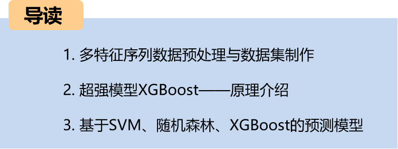
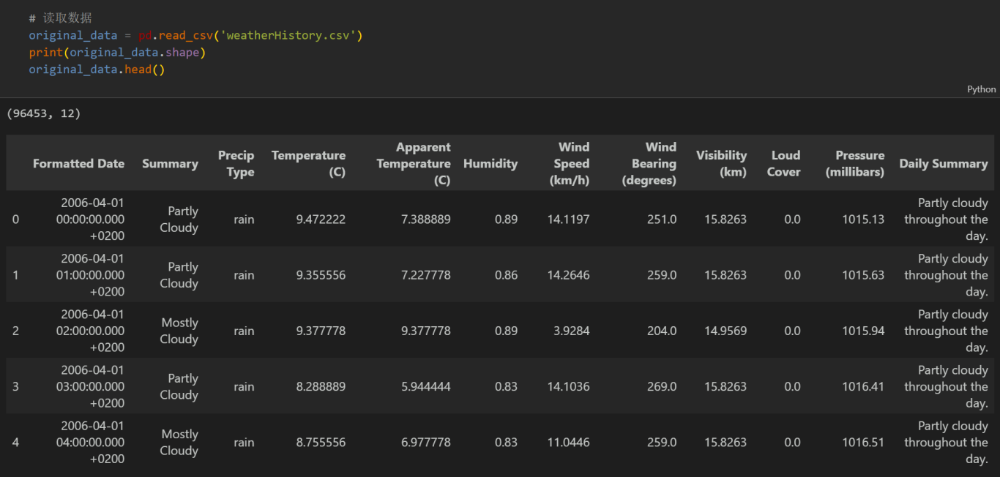

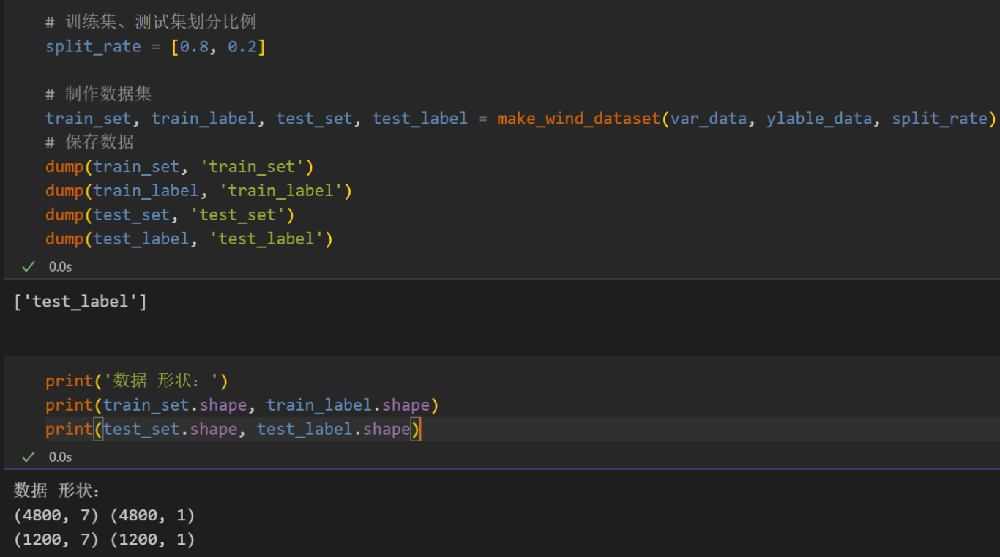
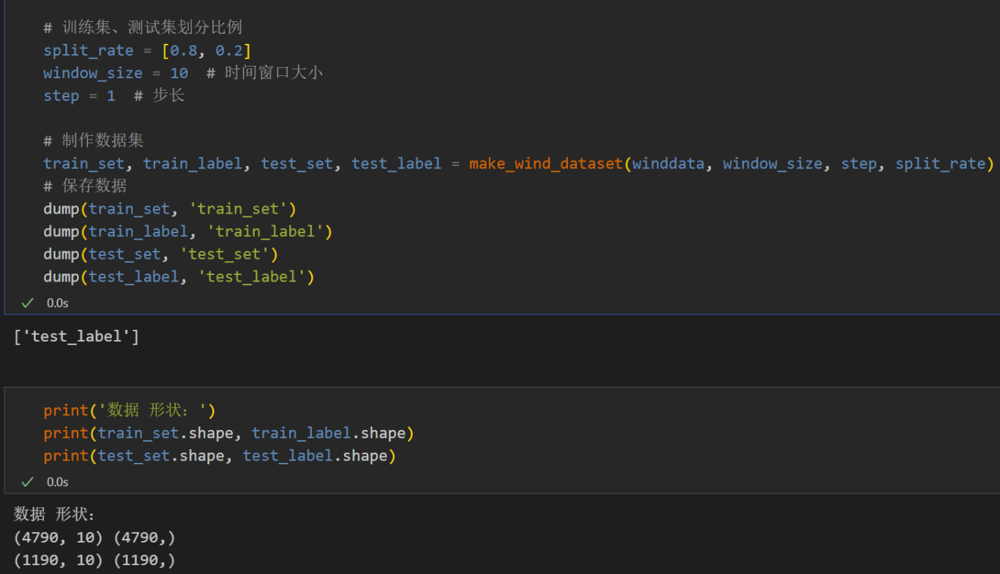
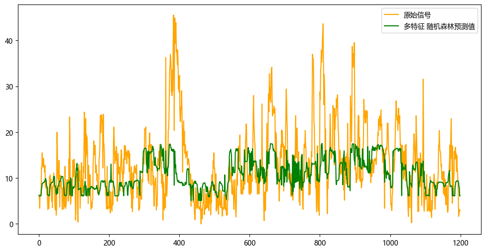
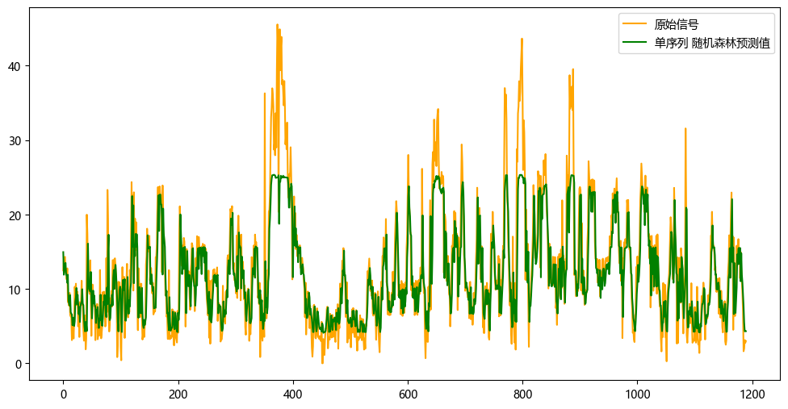
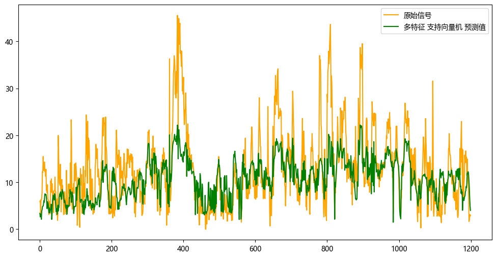
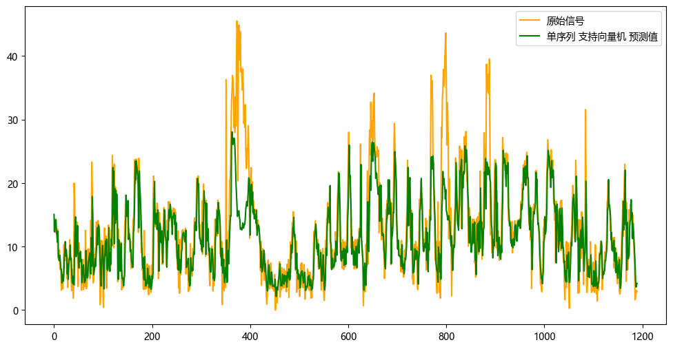
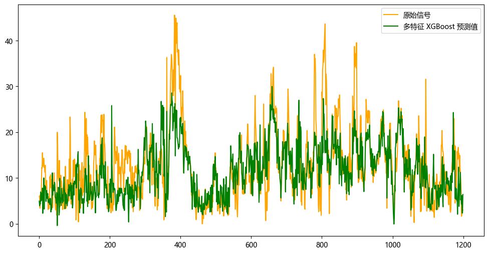
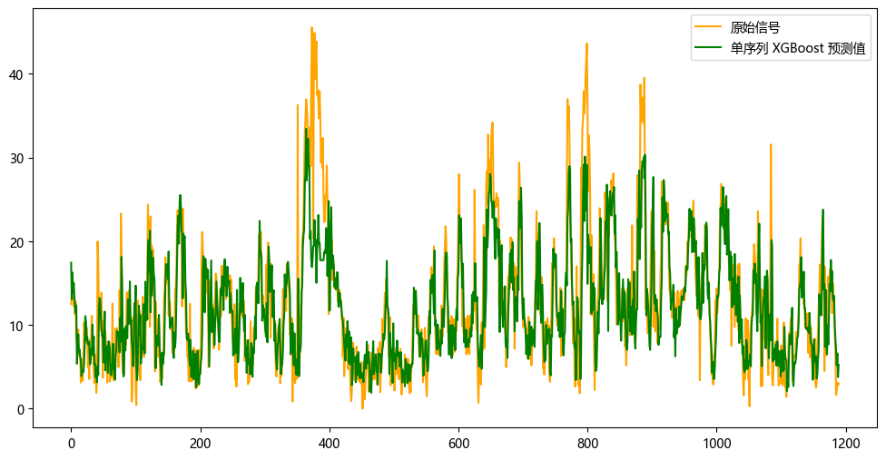
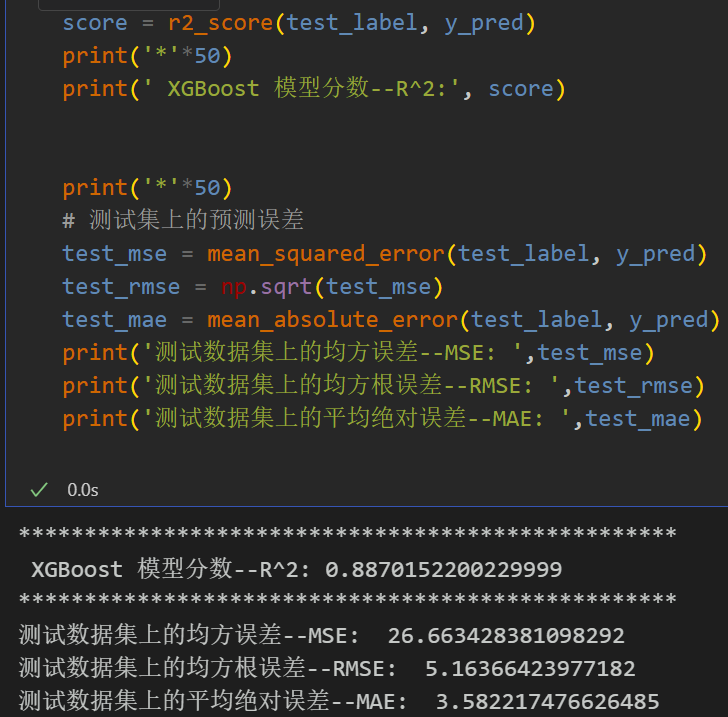

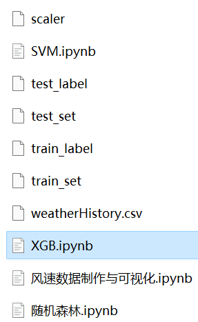

<!-- PAYMENT_BLOCK -->

## Get this dataset

- Payment link (Stripe): [Buy now](https://buy.stripe.com/3cs8yP7sY87d0vu9AB)
- Payment QR code: 

<!-- /PAYMENT_BLOCK -->
